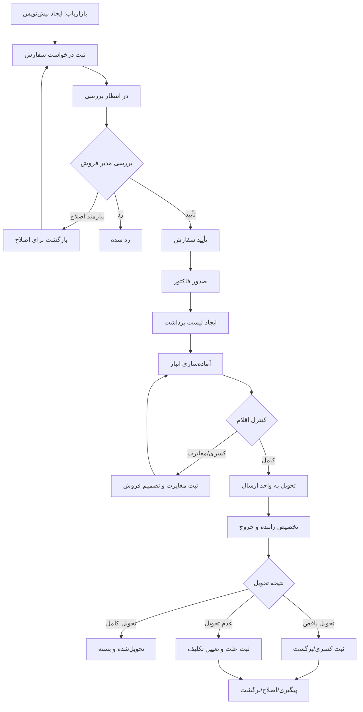

# ۲. گردش کار و وضعیت‌های سفارش

## ۲.۱. نمای کلی

## ۲.۲. وضعیت‌های اصلی

| کد وضعیت | عنوان فارسی | معنی |
|---|---|---|
| `DRAFT` | پیش‌نویس | هنوز برای شرکت ارسال نشده |
| `SUBMITTED` | ثبت‌شده / در انتظار بررسی | درخواست به دفتر مرکزی رسیده |
| `UNDER_REVIEW` | در حال بررسی | کارشناس بررسی را آغاز کرده |
| `NEEDS_REVISION` | نیازمند اصلاح | بازاریاب باید اطلاعات را اصلاح کند |
| `REJECTED` | ردشده | درخواست با ذکر دلیل رد شده |
| `APPROVED` | تأییدشده | مجوز ورود به فروش صادر شده |
| `INVOICED` | فاکتور شده | فاکتور صادر یا در سیستم بیرونی ثبت شده |
| `PICKING` | در حال آماده‌سازی | انبار در حال جمع‌آوری اقلام است |
| `READY_FOR_DISPATCH` | آماده ارسال | کنترل انبار کامل شده |
| `DISPATCHED` | ارسال‌شده | از انبار خارج و به مسیر ارسال سپرده شده |
| `PARTIALLY_DELIVERED` | تحویل ناقص | بخشی از اقلام تحویل شده |
| `DELIVERY_FAILED` | عدم تحویل | تحویل انجام نشده و علت ثبت شده |
| `DELIVERED` | تحویل‌شده | تحویل کامل تأیید شده |
| `CLOSED` | بسته‌شده | عملیات سفارش خاتمه یافته |
| `CANCELLED` | لغوشده | با مجوز و پیش از نقطه غیرقابل بازگشت لغو شده |

وضعیت‌های پرداخت، مرجوعی و تسویه بهتر است جدا از وضعیت لجستیکی سفارش نگهداری شوند؛ برای مثال `payment_status` مستقل از `order_status` باشد.

## ۲.۳. قوانین انتقال وضعیت

- `DRAFT → SUBMITTED`: فقط بازاریاب مالک سفارش یا کاربر مجاز.
- `SUBMITTED → UNDER_REVIEW`: مدیر فروش/بررسی‌کننده.
- `UNDER_REVIEW → NEEDS_REVISION`: فقط با ثبت توضیح روشن.
- `NEEDS_REVISION → SUBMITTED`: بازاریاب پس از اصلاح و ارسال مجدد.
- `UNDER_REVIEW → REJECTED`: با دلیل اجباری.
- `UNDER_REVIEW → APPROVED`: پس از کنترل اطلاعات لازم.
- `APPROVED → INVOICED`: اپراتور فروش یا اتصال حسابداری.
- `INVOICED → PICKING`: ایجاد دستور برداشت.
- `PICKING → READY_FOR_DISPATCH`: پس از ثبت کنترل اقلام.
- `READY_FOR_DISPATCH → DISPATCHED`: تحویل فیزیکی به واحد ارسال و ثبت خروج.
- `DISPATCHED → DELIVERED`: ثبت مدرک/اطلاعات تحویل کامل.
- `DISPATCHED → PARTIALLY_DELIVERED` یا `DELIVERY_FAILED`: با ثبت علت و جزئیات.
- `DELIVERED → CLOSED`: پس از تکمیل کنترل‌های نهایی.

هر انتقال وضعیت باید در جدول تاریخچه ذخیره شود: وضعیت قبلی، وضعیت جدید، کاربر، زمان، توضیح و منبع عملیات.

## ۲.۴. سناریوی خارج از ساعت کاری

1. بازاریاب در هر ساعت سفارش را ثبت می‌کند.
2. سامانه شماره سفارش و زمان ثبت را برمی‌گرداند.
3. سفارش در وضعیت «در انتظار بررسی» قرار می‌گیرد.
4. در صورت تعریف شیفت یا ساعات کاری، سفارش در صف بررسی باقی می‌ماند؛ ساعت ثبت سفارش تغییر نمی‌کند.
5. مدیر فروش در اولین زمان کاری یا در شیفت فعال آن را بررسی می‌کند.
6. زمان انتظار و زمان بررسی در گزارش‌ها جداگانه محاسبه می‌شوند.

## ۲.۵. سناریوی مشتری جدید

1. بازاریاب فرم «درخواست مشتری جدید» را تکمیل می‌کند: نام، شماره تماس، شهر، آدرس، نوع مشتری و توضیحات.
2. درخواست با وضعیت `PENDING_APPROVAL` ثبت می‌شود.
3. مدیر اطلاعات تکراری و صحت اولیه را بررسی می‌کند.
4. در صورت تأیید، شناسه مشتری ایجاد و به بازاریاب تخصیص داده می‌شود.
5. بازاریاب می‌تواند سفارش ثبت کند.
6. اگر مشتری هنوز تأیید نشده باشد، امکان ثبت سفارش نهایی برای او وجود ندارد؛ در صورت نیاز کسب‌وکار می‌توان «سفارش مشروط» را طراحی کرد.

## ۲.۶. سناریوی کسری انبار

1. انباردار مقدار آماده‌شده را برای هر قلم ثبت می‌کند.
2. اگر مقدار آماده‌شده کمتر از مقدار فاکتور باشد، سیستم مغایرت ایجاد می‌کند.
3. انباردار نمی‌تواند بدون ثبت دلیل، مقدار را کم کند.
4. مدیر فروش تصمیم می‌گیرد: تأمین از انبار دیگر، انتظار برای موجودی، اصلاح فاکتور، حذف قلم با تأیید مشتری یا لغو کل سفارش.
5. تصمیم، تأییدکننده و اثر مالی آن ثبت می‌شود.

## ۲.۷. سناریوی تحویل

- **تحویل کامل:** همه اقلام با مقدار نهایی ثبت و نام تحویل‌گیرنده و زمان تحویل ثبت شود.
- **تحویل ناقص:** مقدار تحویل‌شده و تحویل‌نشده برای هر قلم ثبت شود؛ علت و تصمیم بعدی مشخص شود.
- **عدم تحویل:** علت استاندارد (تعطیلی، عدم حضور، امتناع، آدرس اشتباه، مشکل مسیر، عدم امکان پرداخت و غیره) و توضیح آزاد ثبت شود.
- **مدرک تحویل:** امضا، عکس رسید یا کد تأیید پیامکی می‌تواند فعال شود. برای شروع، نام تحویل‌گیرنده و زمان تحویل حداقل داده ضروری است.

## ۲.۸. اعلان‌ها

| رویداد | دریافت‌کننده |
|---|---|
| ثبت سفارش | مدیر/صف بررسی و بازاریاب |
| نیازمند اصلاح یا رد | بازاریاب |
| تأیید سفارش | بازاریاب، اپراتور فروش |
| صدور فاکتور | بازاریاب، انبار |
| کسری انبار | مدیر فروش، انبار |
| آماده ارسال | واحد ارسال، بازاریاب |
| خروج از انبار | بازاریاب، واحد ارسال |
| تحویل کامل/ناقص/ناموفق | بازاریاب، مدیر فروش |
| درخواست مشتری جدید | مدیر فروش |

کانال MVP: اعلان داخل سامانه. پیامک یا پیام‌رسان در مرحله بعد و پس از انتخاب سرویس‌دهنده اضافه شود.
