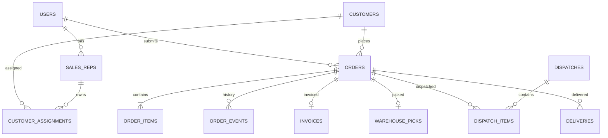

# ۳. مدل داده و API پیشنهادی

## ۳.۱. اصول مدل‌سازی

- شناسه داخلی هر موجودیت UUID یا شناسه عددی امن باشد.
- کدهای قابل مشاهده مانند شماره سفارش و فاکتور، یکتا و خوانا باشند.
- اطلاعات حساس و تغییرپذیر مانند قیمت زمان ثبت سفارش به‌صورت snapshot ذخیره شوند.
- حذف فیزیکی سفارش، فاکتور و رویدادهای مالی ممنوع باشد؛ از وضعیت غیرفعال/لغو و ثبت تاریخچه استفاده شود.
- همه جدول‌های عملیاتی دارای `created_at`, `updated_at` و در صورت نیاز `created_by` باشند.
- برای عملیات حساس از تراکنش پایگاه داده و کنترل هم‌زمانی استفاده شود.

## ۳.۲. موجودیت‌ها

### `users`
- `id`
- `full_name`
- `mobile` (unique)
- `password_hash` یا شناسه احراز هویت OTP
- `role_id`
- `is_active`
- `last_login_at`

### `roles` و `permissions`
- نقش‌ها: بازاریاب، مدیر فروش، اپراتور فروش، انباردار، ارسال، مدیر سیستم، مدیر گزارش.
- مجوزها به‌صورت ریزدانه تعریف شوند؛ مانند `order.approve`, `invoice.create`, `warehouse.pick`, `delivery.confirm`.

### `sales_reps`
- `id`, `user_id`, `employee_code`, `region_id`, `manager_id`, `commission_plan_id` (اختیاری).

### `regions`
- `id`, `name`, `parent_id`, `is_active`.

### `customers`
- `id`, `customer_code`, `name`, `mobile`, `phone_alt`, `city`, `address`, `postal_code`, `customer_type`, `credit_limit`, `payment_terms`, `is_active`.
- اطلاعات اعتبار و بدهی فقط در صورت وجود منبع داده معتبر نمایش داده شود.

### `customer_assignments`
- `id`, `customer_id`, `sales_rep_id`, `valid_from`, `valid_to`, `is_primary`.
- تاریخچه تخصیص مشتری حفظ شود.

### `customer_requests`
- `id`, `requested_by`, `name`, `mobile`, `city`, `address`, `notes`, `status`, `reviewed_by`, `reviewed_at`, `rejection_reason`, `created_customer_id`.

### `products`
- `id`, `sku`, `barcode`, `name`, `description`, `unit_id`, `image_url`, `is_active`, `minimum_order_qty`, `sort_order`.

### `units`
- `id`, `name`, `symbol`.

### `price_lists` و `price_list_items`
- `price_lists`: `id`, `name`, `customer_group_id`, `valid_from`, `valid_to`, `is_active`.
- `price_list_items`: `id`, `price_list_id`, `product_id`, `unit_price`, `tax_rate`.

### `warehouses` و `inventory_balances`
- `warehouses`: `id`, `code`, `name`, `region_id`, `is_active`.
- `inventory_balances`: `id`, `warehouse_id`, `product_id`, `on_hand_qty`, `reserved_qty`, `updated_at`.
- برای موجودی دقیق و حسابرسی، جدول گردش موجودی `inventory_movements` نیز لازم است.

### `orders`
- `id`, `order_number`, `customer_id`, `sales_rep_id`, `status`, `submitted_at`, `requested_delivery_date`, `delivery_address_snapshot`, `customer_name_snapshot`, `notes`, `subtotal`, `discount_total`, `tax_total`, `grand_total`, `currency`, `reviewed_by`, `reviewed_at`, `approved_at`, `cancelled_at`.
- snapshot آدرس و نام مشتری برای حفظ سابقه سفارش ضروری است.

### `order_items`
- `id`, `order_id`, `product_id`, `sku_snapshot`, `product_name_snapshot`, `unit_snapshot`, `qty_requested`, `unit_price_snapshot`, `discount_amount`, `tax_rate_snapshot`, `line_total`, `qty_approved`.

### `order_events`
- `id`, `order_id`, `from_status`, `to_status`, `actor_user_id`, `event_type`, `comment`, `metadata_json`, `created_at`.

### `invoices`
- `id`, `invoice_number`, `order_id`, `external_invoice_id`, `issued_at`, `issued_by`, `subtotal`, `discount_total`, `tax_total`, `grand_total`, `status`, `document_url`.

### `warehouse_picks`
- `id`, `order_id`, `warehouse_id`, `status`, `assigned_to`, `started_at`, `completed_at`.
- `warehouse_pick_items`: `id`, `pick_id`, `order_item_id`, `qty_required`, `qty_picked`, `shortage_reason`.

### `dispatches`
- `id`, `dispatch_number`, `status`, `driver_user_id`, `vehicle_plate`, `route_name`, `departed_at`, `created_by`.
- `dispatch_items`: `id`, `dispatch_id`, `order_id`.

### `deliveries`
- `id`, `order_id`, `dispatch_id`, `status`, `delivered_at`, `recipient_name`, `recipient_mobile`, `proof_file_url`, `failure_reason`, `notes`, `confirmed_by`.
- `delivery_items`: `id`, `delivery_id`, `order_item_id`, `qty_delivered`, `qty_returned`, `qty_not_delivered`.

### `notifications`
- `id`, `user_id`, `type`, `title`, `body`, `related_entity_type`, `related_entity_id`, `read_at`, `created_at`.

### `audit_logs`
- `id`, `actor_user_id`, `action`, `entity_type`, `entity_id`, `before_json`, `after_json`, `ip_address`, `created_at`.

## ۳.۳. روابط مهم



## ۳.۴. API پیشنهادی

پیشوند نمونه: `/api/v1`. تمام درخواست‌ها باید احراز هویت و مجوز نقش را بررسی کنند.

| Method | Endpoint | کاربرد |
|---|---|---|
| `POST` | `/auth/login` | ورود |
| `POST` | `/auth/otp/request` | درخواست کد یک‌بارمصرف |
| `GET` | `/me` | اطلاعات کاربر جاری |
| `GET` | `/customers` | فهرست مشتریان مجاز |
| `POST` | `/customer-requests` | درخواست مشتری جدید |
| `GET` | `/products` | جست‌وجوی کالا |
| `GET` | `/products/{id}/price` | قیمت قابل اعمال برای مشتری |
| `POST` | `/orders` | ایجاد پیش‌نویس سفارش |
| `PATCH` | `/orders/{id}` | ویرایش پیش‌نویس/اصلاحیه |
| `POST` | `/orders/{id}/submit` | ارسال سفارش برای بررسی |
| `GET` | `/orders` | فهرست سفارش با فیلتر |
| `GET` | `/orders/{id}` | جزئیات سفارش و تاریخچه |
| `POST` | `/orders/{id}/review` | ثبت نتیجه بررسی |
| `POST` | `/orders/{id}/approve` | تأیید سفارش |
| `POST` | `/orders/{id}/reject` | رد با دلیل |
| `POST` | `/orders/{id}/request-revision` | درخواست اصلاح |
| `POST` | `/orders/{id}/invoice` | صدور/ثبت فاکتور |
| `POST` | `/orders/{id}/warehouse-pick` | ایجاد دستور برداشت |
| `PATCH` | `/warehouse-picks/{id}` | ثبت مقادیر آماده‌شده |
| `POST` | `/warehouse-picks/{id}/complete` | تکمیل کنترل انبار |
| `POST` | `/dispatches` | ایجاد محموله ارسال |
| `POST` | `/dispatches/{id}/depart` | ثبت خروج |
| `POST` | `/orders/{id}/delivery-result` | ثبت نتیجه تحویل |
| `GET` | `/reports/sales` | گزارش فروش |
| `GET` | `/reports/sales-reps` | گزارش بازاریاب‌ها |
| `GET` | `/reports/order-funnel` | گزارش مراحل سفارش |

## ۳.۵. نمونه درخواست ثبت سفارش

```json
{
  "customer_id": "uuid-customer",
  "requested_delivery_date": "2026-11-08",
  "notes": "لطفاً صبح ارسال شود",
  "items": [
    {
      "product_id": "uuid-product-1",
      "qty": 12
    },
    {
      "product_id": "uuid-product-2",
      "qty": 4
    }
  ]
}
```

سرور باید قیمت و مجوز مشتری را خودش محاسبه و اعتبارسنجی کند؛ مبلغ ارسالی از مرورگر قابل اعتماد نیست.

## ۳.۶. نمونه پاسخ

```json
{
  "order_number": "ORD-1405-000123",
  "status": "SUBMITTED",
  "message": "سفارش شما با موفقیت ثبت شد و در انتظار بررسی است."
}
```

## ۳.۷. قواعد فنی API

- برای جلوگیری از سفارش تکراری، در ثبت سفارش از `Idempotency-Key` پشتیبانی شود.
- فیلترها: وضعیت، بازاریاب، مشتری، شهر، تاریخ ثبت، تاریخ تحویل و شماره سفارش.
- فهرست‌ها صفحه‌بندی شوند.
- عملیات تغییر وضعیت فقط از endpointهای مشخص انجام شود؛ تغییر مستقیم فیلد status با PATCH عمومی ممنوع.
- همه خطاها ساختار ثابت شامل `code`, `message`, `details` داشته باشند.
- دسترسی به فایل رسید/امضا از طریق لینک امن و زمان‌دار باشد.
